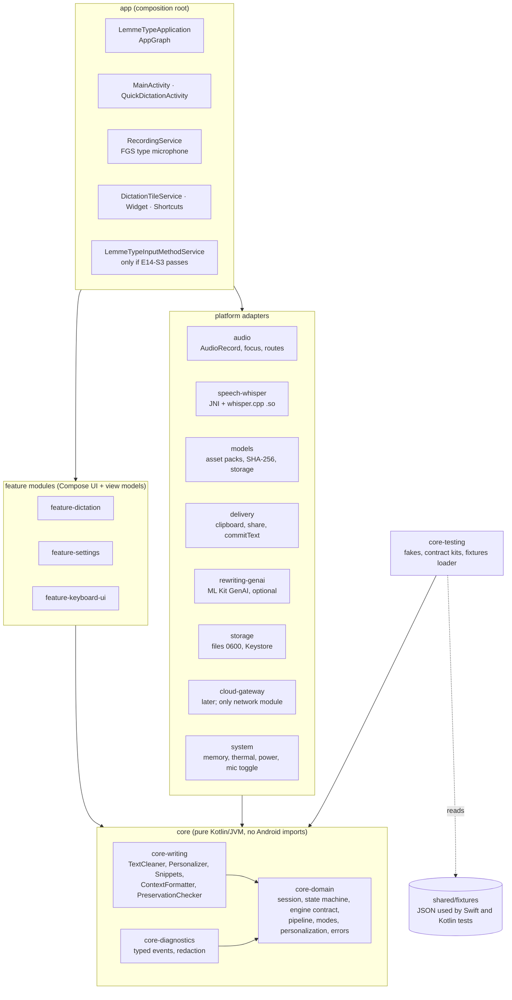

# LemmeType for Android — architecture, feasibility, and delivery plan

- Status: **Proposed** (planning only; no Android code exists yet). Decision record: [ADR 0035](../decisions/0035-android-app.md).
- Date: 2026-11-13. Repository evidence is from `main` at `643717d` (PR #165).
- Backlog: [Epic 14](../backlog/epic-14-android-foundation.md) · [Epic 15](../backlog/epic-15-android-keyboard.md) ·
  [Epic 16](../backlog/epic-16-android-writing-and-models.md) · [Epic 17](../backlog/epic-17-android-languages-and-cloud.md) ·
  [Epic 18](../backlog/epic-18-android-beta-release.md)
- Device evidence record: [`docs/testing/android-feasibility.md`](../testing/android-feasibility.md)

How to read the labels in this document:

| Label | Meaning |
|---|---|
| **Fact** | Stated in official Android or Google Play documentation (linked in [Sources](#17-sources)) |
| **Device test** | Plausible, but must be shown on a physical phone before we promise it |
| **Proposal** | Our design choice; can change in review |

---

## 1. Executive summary

**Recommendation: build a native Android app (Kotlin, Jetpack Compose, Coroutines) in
`android/` of this repository. Share contracts with the Apple apps, not code.**

- **Why native.** Almost everything LemmeType does on a phone is a platform service:
  microphone, foreground service, notification, keyboard (input method), clipboard, native
  Whisper. A cross-platform UI layer would sit on top of the hard parts, not replace them.
- **Why not share Swift code (yet).** The Swift `Domain` module is pure (only `Foundation`
  and `Synchronization`), and the Swift SDK for Android is now official. But compiling it for
  Android adds the Swift runtime, a JNI bridge for async APIs, and ties Apple CI to Android.
  A short spike (E14-S5) measures this; it is not on the critical path.
- **What we share instead.** JSON fixtures that both platforms test against: the cleanup
  corpus, the model catalog (file, size, SHA-256), mode and personalization archive formats,
  corpus manifests, and diagnostics event names. Drift shows up as a red test, not a user bug.
- **Engine.** whisper.cpp through the NDK, with the **same model files and checksums** as the
  Mac and iPhone. Android's built-in `SpeechRecognizer` is not used in Local mode because
  Android says it "is likely to stream audio to remote servers".
- **Biggest Android advantage.** A keyboard (input method) on Android is told which app it is
  in and may be able to record audio itself. That could give the one-tap "speak into WhatsApp"
  flow that iOS makes hard. It is a **device test**, so the keyboard is gated (Phase 0 spike,
  Phase 4 build).
- **Strongest privacy claim.** Beta 1 ships with **no `INTERNET` permission at all**. The
  operating system then blocks every socket the app could open. Models arrive through Google
  Play asset delivery and are hashed against the same pins as Apple (device test E14-S4).
- **First beta.** English, Local only, Quick Dictation with review and Copy, entry from a
  Quick Settings tile, a widget, and an app shortcut; the keyboard only if its spike passes.
  Small closed test first (Play requires 12+ testers for 14 days for new personal accounts).

Analogy: the Apple apps and the Android app are two restaurants with one recipe book. We
share the recipes (fixtures and rules) and taste-test both kitchens against them, instead
of trying to ship one kitchen to two cities.

---

## 2. Current Apple implementation (evidence-based)

### 2.1 What exists

Verified by reading `main` (`643717d`): code, tests, project spec, and decisions.

| Area | What is implemented | Evidence |
|---|---|---|
| Shape | One Swift package, 14 library modules; Mac app, iPhone/iPad app, keyboard extension, widget extension, shared iOS target | `Packages/LemmeTypeKit/Package.swift`, `App/` (`LemmeType`, `LemmeTypeiOS`, `LemmeTypeKeyboard`, `LemmeTypeiOSWidgets`, `LemmeTypeiOSShared`) |
| Module rules | `Domain` (pure, Foundation + Synchronization) ← `Support` ← platform modules; `UI` depends on Domain + Support only; one composition root per app | `Package.swift`, `AppComposition.swift`, `IOSComposition.swift` |
| Recording | `RecorderStateMachine` (pure transition table), `RecordingCoordinator`, `AudioCaptureService` (16 kHz mono Float32, 0600 temp file, purge at launch), `RecordingLimits.handheld` = 5 min | `Domain/RecorderStateMachine.swift`, `Domain/RecordingLimits.swift`, `Audio/` |
| Engines | `SpeechRecognitionEngine` contract + `RecognitionRunner`; Apple Speech (on-device only); whisper.cpp 1.9.2 XCFramework; `NoSpeechGate`, `RepetitionLoop` (ADR 0028); cloud engine via gateway (ADR 0033) | `Recognition/`, `Recognition/Cloud/GatewayService.swift` |
| Models | `ModelCatalog`: six Whisper files pinned by URL, size, SHA-256, host allowlist `huggingface.co`; tiers, memory, device fit, handheld requirements | `Domain/ModelCatalog.swift`, `ModelAssets/` |
| Writing | `TextCleaner` (Exact, Clean with ordered rules and protected spans), `ContextFormatter`, `Personalizer`, `SnippetMatcher`, `StyleOptions` + `PreservationChecker` | `Domain/` |
| Modes and data | `DictationMode` (engine, language, writing, style, output), `ModeResolver`, `PersonalizationLibrary` + versioned archive | `Domain/DictationMode.swift`, `Domain/PersonalizationArchive.swift` |
| Rewriting | Apple Foundation Models, fresh session per request, opt-in real-model test | `Editing/` |
| iOS flows | Quick Dictation (record → review → expiring local-only Copy); App Intent "Start Dictating"; Action Button "Dictate Anywhere" with a status-only Live Activity; LemmeType keyboard that reads the result from an App Group **without Full Access** and inserts it | `UI/Mobile/`, `App/LemmeTypeiOS/ActionDictation.swift`, `App/LemmeTypeKeyboard/`, ADR 0032 |
| Paid launch | StoreKit 2 subscription (`Subscriptions` module), entitlement gate, gateway client with 15-minute tokens | ADR 0034, E13-S4/S5 (PRs #164, #165) |
| Privacy guardrails | Network allowlist (3 files), `make network-check`, `make security-check` (entitlements, usage strings, dependencies, Hardened Runtime, keyboard Full Access off), `make privacy-check`, `make privacy-docs-check`, canary and socket-probe tests | `docs/security/`, `scripts/check-*.{sh,py}` |
| Tests | 1,139 Swift Testing `@Test`s in the package; 60 `@Test` + 54 XCTest functions in app targets; corpus evaluation on Mac and in the iPhone app | `Packages/LemmeTypeKit/Tests`, `App/*Tests`, `make evaluation`, `make evaluation-ios` |
| Device evidence | iPhone: MA-66 Demonstrated (first run, microphone prompt). Keyboard and Action Button results recorded in ADR 0032 and a spike branch, not in `ios-feasibility.md` | `docs/testing/ios-feasibility.md`, ADR 0032 |

### 2.2 Gaps between documents and code

Code and tests win. These documents are stale and should be fixed (section 16 lists edits).

| Document says | Code shows | Impact |
|---|---|---|
| `README.md`: "Epic 8 (iPhone and iPad) has not started" | iOS app, keyboard, widgets, App Store scripts, StoreKit | Readers underestimate the mobile work |
| `AGENTS.md`: "Epic 1 in progress"; skills in `.Codex/skills/` | Epics 1–13 largely built; skills in `.claude/skills/` | Agents using `AGENTS.md` get wrong context |
| ADR 0027 / `docs/release/app-store.md`: "no extension targets", "no App Groups, no background modes" | App Group, `UIBackgroundModes: audio`, keyboard and widget extensions (ADR 0032, Proposed) | App Store setup steps are wrong; ADR 0027 needs a "superseded in part" note |
| Planning prompt: iOS uses "clipboard delivery … because iOS does not permit insertion" | Also keyboard insertion without Full Access (ADR 0032) | Android parity target is "keyboard insertion", not just Copy |
| `docs/roadmap.md` lists Epics 1–8 only | Epics 9–13 exist as backlog files | Roadmap is not the full picture |
| `docs/testing/ios-feasibility.md`: one row Demonstrated | ADR 0032 records more device results | Evidence is split over two places |
| `docs/product-brief.md` is Mac-only, MVP-era | Paid, partly cloud iPhone launch (Epic 13) | Brief does not describe the current product |
| ADR 0032 and 0030: Proposed | 0032's code is merged on `main` | Status words do not match reality |
| This checkout's branch `feature/cloud-one-step-setup` | 21 commits behind `main` (no Epic 13) | Plan was written against `main` to avoid this |

### 2.3 What Android can reuse

| Reuse as | Items |
|---|---|
| **Same files** (copied or fetched, verified by checksum) | Whisper model files and SHA-256 pins; benchmark corpus sentences (`docs/testing/benchmark-corpus.json`); corpus manifests and evaluation report format; gateway API (`openapi.yaml` in `speech-gateway`) |
| **Same rules, ported to Kotlin, proven by shared fixtures** | `TextCleaner` + `CleanupRules` (Exact/Clean), `Personalizer`, `SnippetMatcher`, `ContextFormatter`, `RecorderStateMachine`, `ModeResolver`, `DictationMode` built-ins, `PerformancePlan`/`ModelFit`, `RepetitionLoop`, `NoSpeechGate` thresholds, `PreservationChecker`, `LanguageScope`, `LanguageSupportMatrix` |
| **Same formats** | Personalization archive (import a Mac/iPhone export on Android), diagnostics event names and the "identifiers only" rule, `StyleInstruction` text |
| **Same process** | Story template, readiness review, ADRs, threat-model table checked by a script, manual acceptance numbering, evaluation thresholds |

### 2.4 What Android cannot reuse

| Apple piece | Why not | Android replacement |
|---|---|---|
| SwiftUI views, AppKit windows, `MenuBarExtra` | Apple UI frameworks | Jetpack Compose |
| Apple Speech (`SFSpeechRecognizer`) | Apple framework | whisper.cpp only in Local mode |
| Foundation Models | Apple Intelligence only | ML Kit GenAI (Gemini Nano) where supported |
| App Intents, Action Button, Live Activity, Control Center | Apple system features | App shortcuts, Quick Settings tile, widget, foreground-service notification |
| App Groups, keyboard extension, `textDocumentProxy` | Apple extension model | `InputMethodService` in the same app; `InputConnection.commitText` |
| `AVAudioSession`, `AVAudioEngine` | Apple audio | `AudioRecord` (or AAudio), `AudioManager` |
| Keychain, `UIPasteboard`, StoreKit | Apple services | Android Keystore, `ClipboardManager`, Play Billing |
| whisper.cpp **XCFramework** | Apple binary | whisper.cpp built from the same pinned source with the NDK |
| `xcodegen`, `xcodebuild`, Swift lint tools | Apple toolchain | Gradle, Android lint, ktlint/detekt |

---

## 3. Android and iOS capability comparison

| Capability | iOS (today) | Android | Label |
|---|---|---|---|
| Keyboard can record audio | No, with or without Full Access | Plausible: the keyboard runs in our own app process with our `RECORD_AUDIO` grant; being the current input method is a listed exemption for starting a foreground service | Device test (E14-S3) |
| Keyboard knows the host app | No | Yes: `EditorInfo.packageName` | Fact |
| Keyboard inserts text | `textDocumentProxy.insertText` | `InputConnection.commitText` | Fact |
| Detect password fields | Secure text entry | `EditorInfo.inputType` password variations; `IME_FLAG_NO_PERSONALIZED_LEARNING` hint | Fact |
| Record from the background | Only with `audio` background mode, Live Activity, intent | Not allowed: a `microphone` foreground service must start from a visible activity or listed exemptions (notification, widget) | Fact |
| Visible recording state | Live Activity, orange dot | Ongoing notification + system microphone indicator (Android 12+) | Fact |
| One-press hardware start | Action Button (some models) | No standard key. Quick Settings tile, widget, app shortcut, notification action. Vendor side-key "open app" settings vary | Fact / Device test |
| System mic switch | Settings per app | Plus a global microphone toggle (Android 12+): apps get **silent audio**, not an error | Fact |
| Insert into other apps without a keyboard | Not possible | Only through Accessibility Service, which Play restricts | Fact |
| System speech recognizer | Apple Speech with on-device flag | `SpeechRecognizer` may stream to servers; `createOnDeviceSpeechRecognizer` (API 31) runs in another app | Fact |
| On-device language model | Foundation Models (Apple Intelligence devices) | Gemini Nano via ML Kit GenAI on some devices (beta) | Fact |
| Prove "no network" | Code allowlist + socket probe | Same, **plus** simply omitting the `INTERNET` permission | Fact |
| Store testing | TestFlight | Internal test (no review) → closed test (12+ testers × 14 days for new personal accounts) → production | Fact |
| Device variety | Few models | Many vendors, memory sizes, aggressive battery managers | Fact |

---

## 4. Technology decision

Scores: 1 (poor) – 5 (best) for LemmeType's needs.

| Criterion | 1. Native Kotlin + Compose | 2. KMP shared logic + native UI | 3. Flutter / React Native | 4. Shared native core (Swift SDK for Android, C++, Rust) |
|---|---|---|---|---|
| Reuse of current Swift code | 2 — rules re-written, guarded by shared fixtures | 2 — a third copy, or Apple rewrite | 1 | 4 — Swift `Domain` as is (if spike passes) |
| On-device Whisper | 5 — JNI to whisper.cpp, as the official example | 5 — same JNI | 3 — plugin bridge | 5 |
| App and model size | 5 — Kotlin only + one `.so` | 4 | 3 — engine runtime | 3 — Swift runtime + Foundation in the APK (measure) |
| Latency, memory, battery | 5 | 5 | 4 | 4 — extra bridge, second runtime |
| Keyboard (IME) support | 5 — first-class | 5 | 2 — IME is native anyway | 4 — UI still Kotlin |
| Foreground service, audio | 5 | 5 | 3 | 5 (Kotlin side) |
| Security and privacy | 5 — one toolchain to audit | 4 | 3 — more dependencies | 3 — second toolchain, JNI surface |
| Testing complexity | 5 — JUnit, Robolectric, instrumentation | 3 | 3 | 2 — two test stacks across a bridge |
| Long-term maintenance | 4 — two copies of pure rules | 3 | 3 | 3 — Apple package must stay Android-buildable |
| Developer and agent productivity | 5 — standard, well documented | 3 | 4 | 2 |
| Risk to Apple apps | 5 — none | 3 — tempts Apple changes | 5 | 2 — Apple CI gains an Android job |
| **Total (of 55)** | **51** | **42** | **34** | **37** |

**Decision: Option 1.** It is the simplest design that meets every requirement, and it
cannot destabilize the Apple apps. Option 4 (Swift SDK for Android) is the only one with
real reuse; spike E14-S5 measures it with clear pass rules (APK growth ≤ 15 MB, cold call
≤ 5 ms, Apple CI unchanged). Even if it passes, it would replace only the pure-rules
port, not the Android architecture.

---

## 5. Proposed Android architecture

### 5.1 Diagram

Arrows mean "depends on". Nothing points up into `app` or sideways between platform modules.



Plain-text version:

```
app ──► feature-* ──► core-domain ◄── core-writing
 │                        ▲    ▲
 └──► platform adapters ──┘    └── core-diagnostics
         (audio, speech-whisper, models, delivery, rewriting-genai,
          storage, system, cloud-gateway[later])
core-testing ──► core-*      core-testing ··reads··► shared/fixtures/*.json
```

### 5.2 Module rules (enforced in Gradle and by a check script)

| Rule | Why | How enforced |
|---|---|---|
| `core-*` are plain Kotlin/JVM modules, no `android.*` imports | Fast JVM tests; mirrors Swift `Domain` | `kotlin("jvm")` plugin; lint rule |
| Feature modules depend on `core-*` only, never on a platform adapter | UI is testable with fakes | Gradle dependency graph check |
| Only `app` constructs platform adapters | One composition root, like `AppComposition` | Code review + module graph check |
| Only `cloud-gateway` may use networking APIs; it does not exist in beta 1 | Network silence | `scripts/check-android-network.sh` + manifest check |
| No analytics, ads, crash-reporting, or remote-config SDKs | Privacy | `docs/security/android-dependencies-allowlist.txt` |
| JNI surface lives only in `speech-whisper` | One native boundary to audit | Module graph check |

### 5.3 Component responsibilities

| Component | Responsibility | Key types (proposal) | Apple counterpart |
|---|---|---|---|
| `app` | Composition root, manifest, services, tile, widget, IME declaration | `AppGraph`, `RecordingService`, `DictationTileService`, `LemmeTypeInputMethodService` | `IOSComposition`, `AppComposition` |
| `feature-dictation` | Quick Dictation screen, review, errors and recovery | `QuickDictationViewModel`, `ReviewScreen` | `QuickDictationModel/View` |
| `feature-settings` | Engine, models, modes, personalization, privacy, about | `ModelsViewModel`, `PrivacyViewModel` | `UI` settings models |
| `feature-keyboard-ui` | Keyboard view: typing keys, mic key, recording strip, review chips | `KeyboardViewModel` | `App/LemmeTypeKeyboard` |
| `core-domain` | `DictationSession`, `RecorderStateMachine`, `SpeechEngine` contract, `RecognitionRunner`, `TranscriptionPipeline`, `DictationMode`, `ModeResolver`, `PersonalizationLibrary`, `ModelCatalog` (from fixture), `LanguageScope`, typed errors | Kotlin data classes, sealed interfaces | `Domain` |
| `core-writing` | Exact/Clean cleanup, protected spans, personalization pass, snippets, context formatting, fact-preservation check | `TextCleaner`, `Personalizer`, `SnippetMatcher`, `PreservationChecker` | `Domain` writing types |
| `core-diagnostics` | Event names as constants, values typed; identifiers only | `DiagnosticEvent`, `DiagnosticsBuffer` | `Diagnostics.swift` |
| `audio` | 16 kHz mono Float32 capture, level meter, 0600 temp file in no-backup storage, purge at start, focus, route and call events, silent-mic detection | `AudioCaptureService`, `AudioRecordSource` | `Audio` |
| `speech-whisper` | JNI to whisper.cpp; load only verified files; decoding settings from ADR 0028; cancellation | `WhisperEngine`, `WhisperNative` | `WhisperEngine` |
| `models` | Catalog, delivery (asset packs or consented download), SHA-256 verify, activate, remove, device fit | `ModelStore`, `ModelFit` | `ModelAssets` |
| `delivery` | Copy (sensitive flag, expiry), Share sheet, keyboard `commitText` with target guard | `ClipboardCopier`, `KeyboardInserter` | `Delivery` |
| `rewriting-genai` | Optional rewrite; availability with reason | `GenAiRewriter` | `Editing` |
| `storage` | Owner-only files, versioned JSON, unreadable files moved aside, Keystore for any secret | `FilePersonalizationStore` | `Support` stores |
| `system` | Memory (`onTrimMemory`), thermal status, Battery Saver, microphone toggle state | `SystemConditionsMonitor` | `Lifecycle` |
| `cloud-gateway` (later) | Gateway client, consent version, Play Billing proof | `GatewayClient` | `Recognition/Cloud` |
| `core-testing` | Fakes for every adapter, engine contract kit, fixture loader | `FakeAudioSource`, `SpeechEngineContract` | `TestSupport` |

### 5.4 Shared, platform-independent assets

New top-level folder `shared/fixtures/` (proposal). Apple keeps its code; a Swift test
checks each file equals what Swift produces, so the files cannot drift from the Mac.

| File | Content | Swift check | Kotlin check |
|---|---|---|---|
| `cleanup-corpus.json` | Before/after cases from `TextCleanerTests` (Exact, Clean, each rule) | Corpus test reads the JSON | `TextCleanerFixtureTest` |
| `model-catalog.json` | Id, file, bytes, SHA-256, tier, memory, multilingual | Equals `ModelCatalog.all` | Store verifies against it |
| `modes-builtin.json` | `exact`, `clean`, `message`, `proper-english` definitions | Equals built-ins | Resolver tests |
| `personalization-archive-v*.json` | Sample archives (synthetic) | Decodes | Import tests |
| `recorder-transitions.json` | Allowed (state, event) → state rows | Equals the transition table | State machine test |
| `diagnostics-events.json` | Event names and keys | Names exist | Names match constants |
| corpus manifests (existing) | `docs/testing/benchmark-corpus.json`, `docs/testing/corpus/*.json` | Existing | Android evaluation |

All fixture text is synthetic. No real user audio or transcripts, ever.

---

## 6. Android user experience

### 6.1 Flows

```
Quick Dictation (beta 1)
  Tile / widget / shortcut / app icon
    → QuickDictationActivity on screen (recording starts, notification appears)
    → Stop  → "Transcribing…" → Review: [Copy] [Share] [Retry] [Discard]
    → Copy: "Copied. Paste it in your app." (sensitive flag; cleared after the expiry if we still own it)

Keyboard (Phase 4, only if E14-S3 passes)
  In WhatsApp, tap a text field → LemmeType keyboard → tap 🎤
    → recording strip + notification (if a service is used) → tap 🎤 again
    → Exact/Clean: text committed once into the same field
    → Rewritten/translated: review chips [Insert] [Original] [Discard]
```

### 6.2 Entry points

| Entry point | How it works | Label |
|---|---|---|
| App icon + **app shortcut** "Dictate" | Opens `QuickDictationActivity`; recording starts once visible | Fact (shortcuts API) |
| **Quick Settings tile** | `TileService` starts the activity with `startActivityAndCollapse(PendingIntent)` (Android 14+); the activity starts the service. Starting the microphone service straight from the tile, with no activity, is a device test | Fact / Device test |
| **Home-screen widget** | Button → `PendingIntent`; widget interaction is a listed exemption for while-in-use services | Fact; device test for start latency |
| **Notification action** | While a session runs: Stop, Cancel. Notification interaction is a listed exemption | Fact |
| **Keyboard mic key** | See 6.1; gated | Device test |
| Hardware buttons | No standard. Vendor "open app" side-key settings (Samsung, others) can open LemmeType; we document, not build | Device test, document only |
| Assistant / `VoiceInteractionService` | Not recommended: makes LemmeType a system assistant, out of scope | Proposal (rejected) |
| Lock screen | Recording needs the phone unlocked in beta (same as iOS) | Proposal |

### 6.3 Review, recovery, and errors

| Situation | Behaviour (proposal) | Audio |
|---|---|---|
| Stop | Process, then review | Deleted after processing |
| Cancel | Nothing kept | Deleted at once |
| No speech / empty | "Didn't catch that" + Retry | Deleted |
| Model missing | Offer the model download (size shown) or Tiny | Kept until decision, max 10 min (as iOS `attentionDisplay`) |
| Engine fails | Retry, Copy nothing, Discard | Kept until decision |
| Incoming call / call audio focus | Stop, delete partial, offer Try Again | Deleted |
| Bluetooth headset connects/disconnects | Stop, delete partial, offer Try Again (matches iOS route-loss rule) | Deleted |
| Screen locks / app leaves screen with no service | Stop and process what was said | Deleted after processing |
| Microphone toggle off (silent audio) | Detect all-zero input in first second → stop, "Microphone is turned off in Quick Settings" | Deleted |
| Permission revoked mid-session | Process is killed by Android; next launch purges audio and shows a calm notice | Purged at launch |
| App killed / crash | Launch sentinel → purge leftovers, one-time notice | Purged at launch |
| Low memory (`onTrimMemory` critical) | Refuse model load with reason, or unload after use | — |
| 5-minute limit | Stop and process, tell the user | Deleted after processing |

### 6.4 Secure fields and restricted apps

| Case | Behaviour |
|---|---|
| Password field (`TYPE_TEXT_VARIATION_PASSWORD`, `VISIBLE_PASSWORD`, `WEB_PASSWORD`, `NUMBER_PASSWORD`) | Keyboard hides the mic key; never records or inserts |
| `IME_FLAG_NO_PERSONALIZED_LEARNING` (incognito, sensitive) | Dictation allowed; nothing learned; never added to history (Android has no history in beta anyway) |
| `TYPE_NULL` fields (raw key events only) | Mic key disabled; offer Copy flow |
| Apps that ship their own keyboard (some banking apps) or block third-party keyboards in a work profile (`setPermittedInputMethods`) | LemmeType keyboard is not shown; Quick Dictation + Copy remains |
| Built-in sensitive list (password managers, banking) by `EditorInfo.packageName` | Mic key hidden; user can edit the list (like Mac `ContextPolicy`) |

### 6.5 Main differences users will notice versus iPhone

| iPhone | Android |
|---|---|
| Action Button or keyboard (Full Access off) | Tile, widget, shortcut, or LemmeType keyboard with its own mic key |
| Live Activity shows status | Ongoing notification shows status, with Stop and Cancel |
| Rewriting on Apple Intelligence devices | Rewriting on Gemini Nano devices only; many phones show "unavailable" |
| Copy is local-only and expires | Copy is marked sensitive; Android has no expiring clip, so we clear it ourselves when we can (device test) |

---

## 7. Feature parity matrix

| Feature | Parity | Android notes |
|---|---|---|
| Exact Dictation, Clean Writing | **Full** | Kotlin port, same corpus fixture |
| Vocabulary, replacements, snippets | **Full** | Same archive format; import a Mac export |
| Modes (built-in and custom), default mode | **Full** | |
| App rules (mode per app) | **Android-specific** | Keyboard knows `EditorInfo.packageName`, so rules work in the keyboard flow (iOS cannot) |
| Local English Whisper (Tiny/Base/Small) | **Full** | Same files and pins; Small only on 8 GB+ (Proposed) |
| Model download, verify, remove, device fit | **Android-specific** | Play asset delivery preferred; SHA-256 verify kept |
| Recording with visible state, 5-min limit | **Android-specific** | Notification + mic indicator |
| Quick Dictation → review → Copy | **Full** | Expiry is best effort |
| Share to an app | **Android-specific** | Share sheet; never sends by itself |
| Keyboard insertion | **Android-specific (gated)** | Records in the keyboard if E14-S3 passes |
| Start from a hardware button | **Partial** | No Action Button; vendor keys can open the app |
| Context formatting (text before the cursor) | **Partial (later)** | Keyboard can read text before the cursor; off by default, as on Mac |
| Voice editing of a selection | **Deferred** | Possible through `InputConnection.getSelectedText`; after beta |
| Tone and style rewriting | **Partial** | Gemini Nano devices only |
| Apple Speech engine | **Not feasible** | Not on Android |
| Android `SpeechRecognizer` as Local engine | **Not recommended** | May use a server |
| Hindi/Telugu local, speech-to-English | **Deferred** | After measurement (ADR 0029, 0031 evidence: local Telugu unusable) |
| Opt-in cloud speech | **Deferred** | Via gateway; needs Play Billing proof in the gateway |
| Subscription | **Deferred / open decision** | Play Billing; price parity with $1.99 iOS is the maintainer's call |
| History | **Not in beta** | Same as iOS |
| Insertion via Accessibility Service | **Not recommended** | Play policy; not an accessibility tool |
| Always-listening, wake word | **Not recommended** | Product non-goal |

---

## 8. Speech, translation, and rewriting

### 8.1 Engines

| Need | Recommendation | Where it runs | Label |
|---|---|---|---|
| English dictation | whisper.cpp Base.en (default), Tiny.en on 4–6 GB phones, Small.en on 8 GB+ | On device | Proposal; latency is a device test |
| Apple Speech equivalent | None in Local mode | — | Fact-based |
| Foundation Models equivalent | ML Kit GenAI Rewriting (fixed styles) or Prompt API (Gemini Nano) behind `TextRewriting` | On device, supported phones only | Fact (beta API); device test |
| Hindi/Telugu → text or English | Local multilingual Whisper stays **Debug-only** until measured; cloud through the gateway as on iPhone | Device (eval) / cloud (opt-in) | Proposal |
| Mixed Telugu–English | Cloud (Sarvam via gateway, ADR 0031/0033) | Cloud, opt-in | Proposal |

whisper.cpp build: pinned tag `v1.9.2` (same as Apple) built from source with CMake in
Gradle, NDK r28+ (16 KB aligned), `arm64-v8a`, `-O3`, NEON; source fetched by tag and
checked by SHA-256. GPU (Vulkan) is a later measurement, not beta.

### 8.2 What runs where

| Category | Features |
|---|---|
| Fully on device, no download | Recording, Exact/Clean, personalization, snippets, modes, Copy, keyboard insertion |
| On device after a model download | Whisper English Tiny/Base/Small; later multilingual Whisper (Debug until validated) |
| On device, only on some phones | Rewriting with Gemini Nano (the system manages that model) |
| Only through opt-in cloud | Telugu/Hindi mixed speech, translation to English at useful quality |
| Deferred until measured | Local Indian languages, speech-to-English, GPU decoding, voice editing, context formatting |

### 8.3 Models

| Step | Rule |
|---|---|
| Catalog | `shared/fixtures/model-catalog.json` (same pins as `ModelCatalog`) |
| Delivery (preferred) | Play asset packs: Base.en `fast-follow` (148 MB), Tiny.en and Small.en `on-demand`. Per pack limit 1.5 GB (Fact). Needs no `INTERNET` permission in our app — **device test E14-S4** |
| Delivery (fallback) | One allowlisted downloader, HTTPS to `huggingface.co`, after the user confirms the size, as ADR 0011 |
| Verify | SHA-256 of the file against the catalog before first use each launch; mismatch → delete |
| Storage | `noBackupFilesDir/models/`; excluded from backup; removed by Delete All Local Data |
| Fit | Total RAM and `ActivityManager.MemoryInfo`; refuse a load that does not fit, with the reason |
| Unload | After idle period, on `onTrimMemory(TRIM_MEMORY_RUNNING_CRITICAL)` / `onLowMemory`, and when the keyboard hides for long |

### 8.4 Cloud without weakening Local

- Beta 1 has no cloud and no `INTERNET` permission.
- When cloud is added (Epic 17): a build with `INTERNET`, all network code in `cloud-gateway`,
  cloud engine runs only when the mode names it (same rule as ADR 0031), consent per provider
  and gateway `consentVersion`, banner "Audio is going to the cloud" on the recording strip
  and notification. Local mode keeps a network-silence instrumentation test (section 10.3).
- The gateway today verifies Apple transactions only. Android needs Play Billing purchase
  tokens checked through the Google Play Developer API on the server (cross-repo story).

---

## 9. Phased roadmap

Changes from the suggested phases, and why:

- The **keyboard feasibility spike moves into Phase 0**. On iOS, the cross-app flow is what
  decided the design (ADR 0032). On Android it decides whether recording lives in an
  activity, a service, or the keyboard — it must be known before Phase 2.
- **Privacy guardrails start in Phase 1**, not Phase 7: the Apple repo shows that a check
  added from day one is cheap, a check added later finds old violations.
- **Model delivery is proven in Phase 0**, because it decides whether beta 1 can have no
  `INTERNET` permission.

| Phase | Goal | Stories | Exit criteria |
|---|---|---|---|
| 0 | Audit and feasibility spikes | E14-S1 … E14-S5 | Each spike has a recorded result on ≥ 2 physical phones; ADR 0035 updated |
| 1 | Foundation and architecture | E14-S6 … E14-S9 | `make android-check` green in CI; shared fixtures pass on Swift and Kotlin |
| 2 | Foreground Quick Dictation, local English | E14-S10 … E14-S13 | Record → text on device in airplane mode; no audio left after any ending |
| 3 | Review, copy, safe delivery, entry points, guardrails | E14-S14 … E14-S16 | Copy/Share with review; tile, widget, shortcut work; privacy checks enforced |
| 4 | Keyboard and cross-app workflow (gated) | E15-S1 … E15-S6 | Only if E14-S3 passed: dictation into WhatsApp, Messages, Gmail, Chrome on the device matrix |
| 5 | Modes, personalization, rewriting, model management | E16-S1 … E16-S6 | Same fixtures as Apple; archive import from Mac works; rewrite only where supported |
| 6 | Indian-language evaluation and speech-to-English | E17-S1 … E17-S5 | Measured results; nothing promoted without a `validated` row |
| 7 | Privacy hardening, device validation, beta readiness | E18-S1 … E18-S3 | Thresholds approved; threat model complete; device matrix filled |
| 8 | Play release and monitoring | E18-S4 … E18-S6 | Internal → closed (12+ × 14 days) → staged production; rollback rehearsed |

Beta 1 = Phases 0–3 (+4 if gated in) + the Phase 7 items it needs (E18-S1 privacy,
E18-S3 thresholds) + E18-S4/S5. Phases 5–6 can follow beta 1.

Story list (details, acceptance criteria, and verification are in the epic files):

| Epic | Stories |
|---|---|
| [14 — Android foundation and local Quick Dictation](../backlog/epic-14-android-foundation.md) | S1 whisper.cpp spike · S2 microphone paths spike · S3 keyboard spike · S4 model delivery and no-network spike · S5 Swift SDK spike · S6 project scaffold and CI · S7 shared fixtures · S8 core domain · S9 cleanup port · S10 audio capture · S11 recording service · S12 Whisper engine · S13 model manager · S14 Quick Dictation review and Copy · S15 entry points · S16 privacy guardrails |
| [15 — Android keyboard](../backlog/epic-15-android-keyboard.md) | S1 keyboard decision · S2 keyboard shell and typing · S3 mic key recording · S4 target guard and insertion · S5 per-app rules and sensitive apps · S6 keyboard validation |
| [16 — Writing, personalization, rewriting, models](../backlog/epic-16-android-writing-and-models.md) | S1 modes · S2 personalization and archive import · S3 context formatting · S4 on-device rewriting · S5 model residency and conditions · S6 privacy controls and Delete All |
| [17 — Indian languages and cloud](../backlog/epic-17-android-languages-and-cloud.md) | S1 on-device evaluation harness · S2 multilingual Whisper (Debug) · S3 gateway support for Android · S4 cloud engine and consent · S5 translation review |
| [18 — Beta and release](../backlog/epic-18-android-beta-release.md) | S1 privacy hardening and threat model · S2 accessibility, localization, large screens · S3 device matrix and thresholds · S4 release pipeline and Play setup · S5 closed beta · S6 production rollout and monitoring |

---

## 10. Privacy and security

### 10.1 Principles mapped to Android controls

| Principle | Android control | Check |
|---|---|---|
| Local mode is network-silent | No `INTERNET` permission in beta 1; later, network only in `cloud-gateway` | `scripts/check-android-manifest.py`, `scripts/check-android-network.sh`, instrumentation socket test |
| Never log content | `core-diagnostics` typed events; no `Log.*` with strings outside it; release builds strip `Log.d/v` with R8 | Lint rule + canary tests |
| Temporary audio deleted | 0600 file in `noBackupFilesDir/sessions`, deleted on every ending; purge at process start | Unit tests + `scripts/check-android-no-audio.sh` on emulator |
| Recording always visible | Activity on screen or FGS with ongoing notification; mic indicator | Instrumentation test that the service never runs without its notification |
| Nothing sent automatically | Delivery = Copy, Share sheet, or one `commitText`; no send actions | Code review + no `ACTION_SEND` without chooser |
| Exact never rewrites | Exact uses whitespace normalization only | Shared corpus fixture |
| Cloud is opt-in and separate | Separate module, consent, banner, mode-named only | Tests from ADR 0031 ported |
| Keyboard asks for little | Keyboard declares nothing extra; app permissions: `RECORD_AUDIO`, `FOREGROUND_SERVICE`, `FOREGROUND_SERVICE_MICROPHONE`, `POST_NOTIFICATIONS` | Manifest allowlist |
| No Accessibility shortcut | No `BIND_ACCESSIBILITY_SERVICE` anywhere | Manifest check |
| No backups of private data | `android:allowBackup="false"` or explicit data-extraction rules excluding sessions, models, personalization | Manifest check |

### 10.2 Preliminary threat model (Android)

| ID | Threat | Control | Verification | Residual risk |
|---|---|---|---|---|
| A-01 | Audio or text leaves the phone in Local mode | No `INTERNET` permission (beta 1); later network-module confinement | Manifest check; network check; socket test | A later build adds `INTERNET`; then code confinement only |
| A-02 | A recording stays on disk | Delete on every ending; purge at start; no-backup dir | Unit + emulator check | Power loss until next start |
| A-03 | Another app reads our files | App-private storage (per-app Linux user); 0600 | Unit test of file modes | Rooted device |
| A-04 | Dictated text visible to other apps via the clipboard | Copy only on request; `EXTRA_IS_SENSITIVE`; clear when we still own the clip after the expiry | Unit test; device test of clearing | Clipboard managers on some vendors; Android does not expire clips |
| A-05 | Keyboard records or inserts in a password field | Field-type checks before mic; sensitive-app list | Unit tests on `EditorInfo` fixtures; device matrix | An app using a plain field for a secret |
| A-06 | Text inserted into the wrong field | Insert only if the same editor session (package, field id, input-start count) is still active; otherwise review | Unit tests with fake `InputConnection`; device test | User switches field mid-dictation within the same session |
| A-07 | Recording continues unseen | FGS with notification; stop on cancel, call, route change, limit, `onDestroy` | Instrumentation tests | User dismisses notification (Android 13+): service keeps running and the mic indicator stays — we stop on dismissal (proposal) |
| A-08 | Diagnostics leak content | Typed events, identifiers only; no crash SDK; Play vitals only | Canary tests; dependency allowlist | Android's own ANR traces contain stack frames (no content) |
| A-09 | Tampered model or native library | SHA-256 pins; whisper.cpp source pinned by tag + checksum; Play App Signing | Unit tests; release verify script | Compromised upstream + matching reviewed pin change |
| A-10 | A dependency adds network or tracking | Dependency allowlist with reasons; no analytics/ads/crash SDKs | `scripts/check-android-security.py` | Reviewer approves a bad edit |
| A-11 | Dictated text acts as a prompt to the rewriter | Fixed instruction; dictation as data; `PreservationChecker` | Shared tests | Model may still produce odd wording; user reviews |
| A-12 | Silent microphone (global toggle) produces wrong results | Detect silent input; tell the user | Unit test with zero buffers; device test | — |
| A-13 | A backup or device transfer copies private data | Backup off / excluded | Manifest check; `adb backup` style device test | OEM transfer tools ignoring rules |
| A-14 | Exported component abused by another app (start recording) | Only launcher activity, IME (protected by `BIND_INPUT_METHOD`) and tile (protected by `BIND_QUICK_SETTINGS_TILE`) exported; `RecordingService` not exported | Manifest check | — |
| A-15 | Cloud mode used for an excluded app | Refuse before recording by package name | Unit tests | — |

### 10.3 Automated privacy and security checks (proposed)

| Check | What fails it | Runs in |
|---|---|---|
| `scripts/check-android-manifest.py` | Any permission not in `docs/security/android-permissions-allowlist.txt` (beta 1 forbids `INTERNET`), any exported component not allowlisted, `allowBackup` true, an accessibility service, cleartext traffic allowed | `make android-check`, CI |
| `scripts/check-android-network.sh` | `java.net`, `okhttp`, `HttpURLConnection`, `Socket`, `ktor`, `URL(` in a file outside `docs/security/android-network-allowlist.txt` | CI |
| `scripts/check-android-security.py` | Dependency not in the allowlist; analytics/crash/ads group ids; native library not 16 KB aligned (APK check); release not minified | CI on release builds |
| Socket test (instrumentation) | In Local mode, a full dictation with fakes at the audio edge opens no socket (`/proc/net/tcp*` owned by our uid, plus `TrafficStats.getUidTxBytes` unchanged) | Emulator job |
| Canary tests | A planted phrase in audio-fake transcript, clipboard, and personalization appears in no log, diagnostics event, exception message, or saved file | JVM + instrumentation |
| No-audio check | A `.pcm/.wav/.caf/.m4a` left in the app's sessions dir after the test suite | Emulator job |
| Fixture parity | Kotlin and Swift disagree on a shared fixture | Both CIs |

---

## 11. Device and Android-version test matrix

Proposed minimum: **Android 12 (API 31), 64-bit ARM, 4 GB RAM** (Tiny only below 6 GB).

| Class | Example devices | RAM | Why | Required for beta |
|---|---|---|---|---|
| Google reference | Pixel 9 or 10 | 12 GB | Gemini Nano, 16 KB-page developer option, clean Android | Yes |
| Google older | Pixel 7 or 8a | 8 GB | Common, no/limited Nano | Yes |
| Samsung flagship | Galaxy S24/S25 | 8–12 GB | Largest vendor; One UI battery rules | Yes |
| Samsung mid-range | Galaxy A35/A55 | 6–8 GB | India's common class | Yes |
| Xiaomi / Redmi | Redmi Note 13/14 | 6–8 GB | India; HyperOS background kills, own clipboard UI | Yes |
| OnePlus / OPPO / vivo | OnePlus 12R, vivo V-series | 8 GB | ColorOS/Funtouch battery managers | One of them |
| Low end | 4 GB Android 12+ phone | 4 GB | Tiny only; memory refusal path | Yes |
| Tablet | Galaxy Tab S9 / Pixel Tablet | 8+ GB | Large-screen layout (Android 16 ignores orientation locks at ≥ 600 dp for apps targeting 36) | Yes |
| Foldable | Galaxy Z Fold / Pixel Fold | 12 GB | Configuration changes mid-recording | Nice to have |

| Android version | Why it matters | Coverage |
|---|---|---|
| 12 (API 31) | Minimum; mic toggle, FGS background limits | Physical (low end) |
| 13 (API 33) | Notification permission, dismissible FGS notifications, clipboard preview | Physical or emulator |
| 14 (API 34) | FGS types mandatory, tile `PendingIntent` | Physical |
| 15 (API 35) | 16 KB page devices, BOOT_COMPLETED FGS limits | Physical + 16 KB emulator |
| 16 (API 36) | Target SDK; large-screen changes | Physical |
| 17 (API 37) | Background audio hardening | Physical (Pixel) |

Host apps for delivery tests: WhatsApp, Google Messages, Samsung Messages, Gmail, Chrome
(web textarea and `contenteditable`), Google Keep, a banking app (expect refusal or own
keyboard), a work profile with keyboard restriction. Synthetic sentences only; never send.

---

## 12. Risks, open decisions, and spikes

### 12.1 Risks

| # | Risk | Likelihood | Impact | Mitigation |
|---|---|---|---|---|
| R1 | Keyboard cannot record reliably (while-in-use rules, vendor differences) | Medium | High (loses the best flow) | Spike E14-S3 first; Quick Dictation + Copy is the fallback |
| R2 | Whisper latency on mid-range phones is too slow | Medium | High | Spike E14-S1 per device class; Tiny.en fallback; thresholds by class |
| R3 | Vendor battery managers kill the service or the keyboard process | High on some vendors | Medium | Device matrix; short sessions; never ask users to disable battery optimization by default |
| R4 | Play asset delivery is not usable for models without `INTERNET` | Low–medium | Medium | Spike E14-S4; fallback is the Apple-style consented downloader |
| R5 | Play review questions the microphone FGS declaration or keyboard | Medium | Medium | Clear FGS declaration text + demo video; keyboard Data safety answers |
| R6 | Two copies of rules drift | Medium | Medium | Shared fixtures; fixture change requires both CIs |
| R7 | Gemini Nano unavailable on most target phones | High | Low (rewrite is optional) | "Unavailable" with reason; Exact/Clean unaffected |
| R8 | Clipboard cannot be cleared from the background on some versions | Medium | Low | Clear on next foreground; say "Copied — it stays until you copy something else" honestly |
| R9 | Indian-language quality locally stays poor | High (measured on Mac) | Medium | Cloud opt-in route; do not promise local Telugu |
| R10 | Maintainer bandwidth: two mobile platforms | High | High | Small PRs; keep Android out of Apple CI; agents use these stories as-is |

### 12.2 Open decisions (the maintainer's)

| # | Decision | Recommended default |
|---|---|---|
| D1 | Approve native Kotlin and ADR 0035 | Approve |
| D2 | Application id (cannot change after the first Play upload) | `com.lemmetype.android` |
| D3 | Developer account type: personal (12-tester rule) or organization | Organization if available (no 12-tester gate, D-U-N-S needed) |
| D4 | Beta 1 free, or Play Billing at launch | Free closed beta; billing in Epic 17 |
| D5 | `minSdk` 31 | Approve |
| D6 | Ship the keyboard in beta 1 if its spike passes | Yes, as optional, Quick Dictation stays the default |
| D7 | Shared fixtures folder name and owning reviewer | `shared/fixtures/`, Apple maintainer reviews |
| D8 | Whether `shared/fixtures` work (small Swift test additions) may touch the Apple package | Yes, tests only, no behaviour change |

### 12.3 Technical spikes (Phase 0)

| Spike | Question | Pass rule (Proposed) |
|---|---|---|
| E14-S1 whisper.cpp | Base.en latency, memory, thermal on 3 classes | 10 s utterance → text ≤ 4 s (flagship), ≤ 7 s (mid-range); peak ≤ 650 MB above idle |
| E14-S2 Microphone paths | Can an activity, tile, widget, notification start a visible recording; what ends it | Each path recorded on Android 12, 14, 16/17 |
| E14-S3 Keyboard | Can the IME record and `commitText` into the 6 host apps with Full Access-like prompts avoided | 20 dictations, 3 apps, no wrong-field insert, mic indicator always shown |
| E14-S4 Model delivery | Do asset packs deliver models with no `INTERNET` permission, verifiable by SHA-256 | Base.en installs from internal testing; hash matches; airplane mode works after |
| E14-S5 Swift SDK | Can Swift `Domain` run on Android usefully | APK +≤ 15 MB, call ≤ 5 ms, Apple CI unchanged — otherwise reject |

---

## 13. CI/CD, signing, and Play release plan

### 13.1 Repository and build

```
android/
  settings.gradle.kts, gradle/libs.versions.toml (every version pinned)
  app/ feature-*/ core-*/ audio/ speech-whisper/ models/ delivery/ storage/ system/ rewriting-genai/
  speech-whisper/src/main/cpp/  (CMake; whisper.cpp fetched by tag + SHA-256)
shared/fixtures/
scripts/check-android-*.{py,sh}
.github/workflows/android.yml   (path filter: android/**, shared/**, scripts/check-android-*)
```

| Make target | Does |
|---|---|
| `make android-bootstrap` | Checks JDK 21, Android SDK 36, NDK r28+, CMake |
| `make android-build` | Debug build |
| `make android-test` | JVM unit tests (core, features with fakes) |
| `make android-lint` | Android lint, ktlint, detekt, module-graph check |
| `make android-check` | lint + test + manifest + network + security + fixtures |
| `make android-test-device` | Instrumentation tests on a connected device/emulator |
| `make android-release` | Signed AAB with the upload key (maintainer's machine only) |

### 13.2 CI (GitHub Actions)

| Job | Runner | Blocking |
|---|---|---|
| `android-check` (lint, JVM tests, scripts, fixture parity) | `ubuntu-latest` | Yes |
| `android-emulator` (instrumentation, socket test, no-audio check; API 31 and 36, x86_64) | `ubuntu-latest` with KVM | No at first, Yes before beta |
| `android-16kb` (16 KB emulator image smoke) | `ubuntu-latest` | Before release |
| Swift fixture parity | Existing `make test-unit` (new test) | Yes (already) |

No artifact uploads of logs or test results that could hold user data (same rule as Apple CI).

### 13.3 Signing and Play Console

| Step | Owner | Notes |
|---|---|---|
| Create the Play developer account (personal or organization) | Maintainer | Fee, identity checks |
| Create the app, choose the application id | Maintainer | Id is permanent |
| Enrol in Play App Signing; create the upload key | Maintainer | Upload key stays off CI for beta |
| Store listing, content rating, target audience | Maintainer | |
| **Data safety**: audio and text processed on device only are not "collected" (Fact); declare nothing collected for beta 1; revisit when cloud ships | Maintainer, with `docs/release/play-store.md` | Confirm the "shared with another app on the device" wording for keyboard insertion with Play's form |
| **Foreground service declaration** (`microphone`, with video) | Maintainer | Required for target 34+ |
| Permissions declarations (none restricted in beta 1) | — | `RECORD_AUDIO` is a runtime permission, not a restricted one |
| Internal testing track (fast, no review) | Maintainer | For the team and spike devices |
| Closed testing: ≥ 12 testers opted in for 14 consecutive days (new personal accounts) | Maintainer | Recruit 15–20 to stay above 12 |
| Production: staged rollout 5 % → 20 % → 50 % → 100 % | Maintainer | Halt on Play vitals crash/ANR spikes |

### 13.4 Post-release monitoring

- Play vitals only (crash rate, ANR rate, battery warnings); no third-party crash SDK.
- An in-app "Copy support info" with identifiers and versions only (Apple `SupportSnapshot` style).
- Rollback = halt the staged rollout and publish the previous version with a higher version code.

---

## 14. Documentation updates required

| File | Change |
|---|---|
| `README.md` | Repository status: iOS and keyboard exist; Android planned (link this plan) |
| `AGENTS.md` | Refresh from `CLAUDE.md` (status, skills path `.claude/skills/`), add Android section |
| `CLAUDE.md` | Android commands and module rules once Epic 14 starts |
| `docs/roadmap.md` | Add Epics 9–18 summary lines; Android dependency order |
| `docs/product-brief.md` | Platforms: Mac, iPhone/iPad, Android (planned) |
| `docs/decisions/0027-iphone-ipad-companion.md` | "Superseded in part by ADR 0032" note |
| `docs/release/app-store.md` | App Group, background audio, keyboard extension now exist |
| `docs/testing/ios-feasibility.md` | Copy ADR 0032 device results into the evidence tables |
| `docs/security/threat-model.md` | Android section (A-01 … A-15) once checks exist |
| `docs/security/android-*-allowlist.txt` (new) | Permissions, network files, dependencies |
| `docs/testing/manual-acceptance.md` | Android `MA-` steps (next free numbers after the iOS ones) |
| `docs/release/play-store.md` (new) | Play setup, Data safety answers, FGS declaration text, review notes |
| `.github/scripts/sync_backlog.py` | Register Epics 14–18 only when the maintainer wants GitHub issues |
| `.claude/skills/` | An `android-development` and `android-coding-standards` skill before Phase 1 code |

---

## 15. First pull requests (small and reviewable)

1. This plan, ADR 0035, the Android feasibility record, and Epics 14–18 (docs only).
2. E14-S1 spike branch (not merged), results PR to `android-feasibility.md`.
3. E14-S6 scaffold: empty Gradle build, CI job, `make android-*`, manifest check with `INTERNET` forbidden.
4. E14-S7 `shared/fixtures/cleanup-corpus.json` + Swift parity test (Apple tests only).
5. E14-S9 Kotlin `TextCleaner` passing the fixture.

## 16. Assumptions

- Evidence is `main` at `643717d`; the maintainer's local branches and worktrees may hold more.
- Android behaviour labelled "Device test" is not established; nothing in a store listing
  may claim it before `android-feasibility.md` shows it.
- Thresholds are Proposed until the product owner approves them (same rule as iOS).
- Play policy text was read on 2026-11-13; re-read before submission.

## 17. Sources

Official Android and Google Play documentation, read 2026-11-13:

- [Foreground service types](https://developer.android.com/develop/background-work/services/fgs/service-types)
- [Restrictions on starting a foreground service from the background](https://developer.android.com/develop/background-work/services/fgs/restrictions-bg-start)
- [Background audio hardening (Android 17)](https://developer.android.com/about/versions/17/changes/bg-audio)
- [Create an input method](https://developer.android.com/develop/ui/views/touch-and-input/creating-input-method)
- [EditorInfo](https://developer.android.com/reference/android/view/inputmethod/EditorInfo)
- [InputMethodService](https://developer.android.com/reference/kotlin/android/inputmethodservice/InputMethodService)
- [SpeechRecognizer](https://developer.android.com/reference/android/speech/SpeechRecognizer)
- [Support 16 KB page sizes](https://developer.android.com/guide/practices/page-sizes)
- [Play for On-device AI (beta)](https://developer.android.com/google/play/on-device-ai) and [Play Asset Delivery](https://developer.android.com/guide/playcore/asset-delivery)
- [TileService](https://developer.android.com/reference/android/service/quicksettings/TileService)
- [Copy and paste](https://developer.android.com/develop/ui/views/touch-and-input/copy-paste)
- [Explain access to more sensitive information (microphone toggle)](https://developer.android.com/training/permissions/explaining-access)
- [Android 14 behavior changes: all apps](https://developer.android.com/about/versions/14/behavior-changes-all)
- [`<service>` element (`isolatedProcess`)](https://developer.android.com/guide/topics/manifest/service-element)
- [ML Kit GenAI APIs](https://developers.google.com/ml-kit/genai) and [Gemini Nano](https://developer.android.com/ai/gemini-nano)
- [Target API level requirements](https://support.google.com/googleplay/android-developer/answer/11926878)
- [App testing requirements for new personal developer accounts](https://support.google.com/googleplay/android-developer/answer/14151465)
- [Use of the AccessibilityService API](https://support.google.com/googleplay/android-developer/answer/10964491)
- [Data safety section](https://support.google.com/googleplay/android-developer/answer/10787469)
- [Swift 6.3 released (Swift SDK for Android)](https://www.swift.org/blog/swift-6.3-released/)
- [whisper.cpp Android example](https://github.com/ggml-org/whisper.cpp/tree/master/examples/whisper.android)
